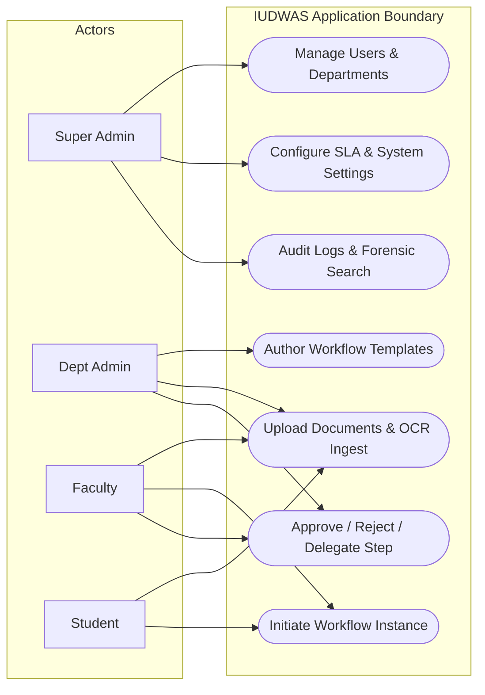
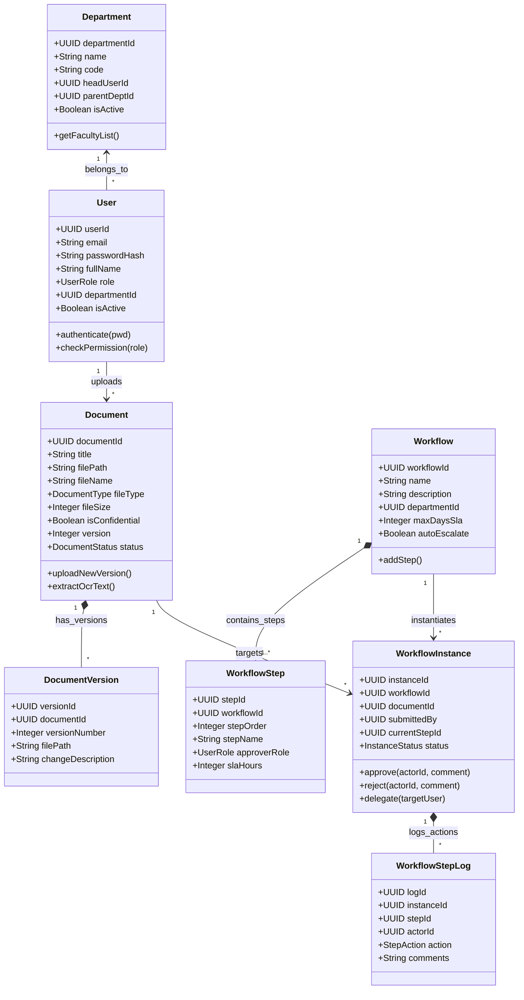
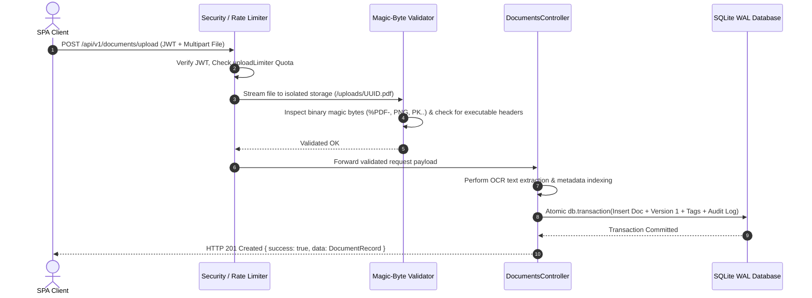
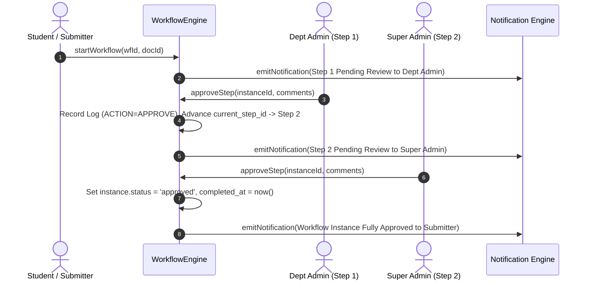
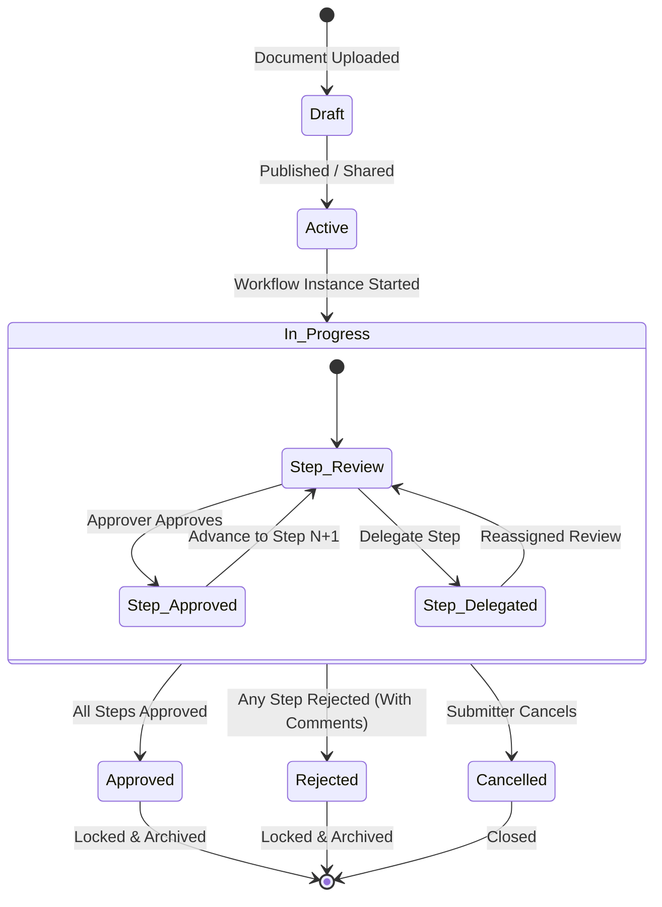

# IUDWAS — Intelligent University Document & Workflow Automation System
## Complete System Architecture, UML Model Suite & Relational Data Dictionary

**Document Version:** 1.0.0 (Production Master)  
**Security Clearance:** 🟢 **GREEN FLAG VERIFIED**  
**Associated PDF File:** [`IUDWAS_System_Documentation.pdf`](./IUDWAS_System_Documentation.pdf)

---

## 1. System Overview & Technology Stack

| Layer / Subsystem | Technology | Architectural Responsibilities |
| :--- | :--- | :--- |
| **Frontend SPA** | React 18, Vite 6, TypeScript 5.7, Tailwind CSS 3.4 | Apple Design System UI, glassmorphism aesthetics, JWT auth state, interactive document OCR & workflow tracking. |
| **Backend API Gateway** | Node.js 24 LTS, Express 4.21, TypeScript 5.7 | RESTful endpoints, centralized JWT authentication, RBAC middleware, 5-tier rate limiting with exponential backoff. |
| **Persistence Engine** | SQLite 3 (Better-SQLite3 11.8) in WAL Mode | 3NF relational schema (15 tables), PRAGMA foreign keys, atomic multi-step workflow transactions. |
| **File Storage & Ingestion**| Multer, FS Streams, Magic-Byte Validator | Isolated disk storage outside web root (`/uploads`), UUID naming, binary header inspection (`%PDF-`, PNG, JPEG, PK..), sandboxed headers. |
| **Intelligence Engine** | Tesseract OCR Bridge, Simulated NLP Classifier | Document text extraction, auto-categorization, semantic search, and interactive assistant chatbot. |

---

## 2. UML Diagrams Suite

### 2.1 Use Case Model

### 2.2 Structural Domain Class Model

### 2.3 Sequence Diagram: Multi-Tier Document Upload & OCR Ingestion

### 2.4 Sequence Diagram: Multi-Step Approval & Delegation Flow

### 2.5 State Machine: Document & Workflow Lifecycle Transitions

---

## 3. Comprehensive Relational Data Dictionary

### 3.1 `departments`
| Column | Type | Constraints | Default | Foreign Key | Description |
| :--- | :--- | :--- | :--- | :--- | :--- |
| `department_id` | TEXT | `PRIMARY KEY` | None (UUID v4) | — | Unique identifier for the department. |
| `name` | TEXT | `NOT NULL UNIQUE` | — | — | Full official name of the department/division. |
| `code` | TEXT | `NOT NULL UNIQUE` | — | — | Short alphanumeric code (e.g. `CSE`, `ECE`). |
| `head_user_id` | TEXT | Nullable | NULL | `users(user_id)` | User ID of the department chairperson/head. |
| `parent_dept_id` | TEXT | Nullable | NULL | `departments(department_id)` | Parent department for hierarchical structures. |
| `is_active` | INTEGER | `NOT NULL` | 1 | — | Active status flag (1 = Active, 0 = Inactive). |
| `created_at` | TEXT | `NOT NULL` | `datetime('now')` | — | ISO 8601 creation timestamp. |

### 3.2 `users`
| Column | Type | Constraints | Default | Foreign Key | Description |
| :--- | :--- | :--- | :--- | :--- | :--- |
| `user_id` | TEXT | `PRIMARY KEY` | None (UUID v4) | — | Unique identifier for the user account. |
| `email` | TEXT | `NOT NULL UNIQUE` | — | — | Normalized lowercase university email address. |
| `password_hash` | TEXT | `NOT NULL` | — | — | Bcrypt salted password hash (10 work rounds). |
| `full_name` | TEXT | `NOT NULL` | — | — | Full legal name of the user. |
| `role` | TEXT | `NOT NULL` | — | `CHECK(role IN (...))` | One of: `SUPER_ADMIN`, `DEPT_ADMIN`, `FACULTY`, `STUDENT`. |
| `department_id` | TEXT | Nullable | NULL | `departments(department_id)` | Assigned academic or administrative department. |
| `employee_id` | TEXT | `UNIQUE` Nullable | NULL | — | University ID or Student Matriculation number. |
| `avatar_url` | TEXT | Nullable | NULL | — | Profile image URL or avatar asset path. |
| `is_active` | INTEGER | `NOT NULL` | 1 | — | Account status (1 = Active, 0 = Deactivated). |
| `last_login` | TEXT | Nullable | NULL | — | Timestamp of most recent successful login. |
| `created_at` | TEXT | `NOT NULL` | `datetime('now')` | — | Registration timestamp. |
| `updated_at` | TEXT | `NOT NULL` | `datetime('now')` | — | Last modification timestamp. |

### 3.3 `refresh_tokens`
| Column | Type | Constraints | Default | Foreign Key | Description |
| :--- | :--- | :--- | :--- | :--- | :--- |
| `token_id` | TEXT | `PRIMARY KEY` | UUID v4 | — | Unique session token identifier. |
| `user_id` | TEXT | `NOT NULL` | — | `users(user_id) ON DELETE CASCADE` | Owner user of the active refresh session. |
| `token_hash` | TEXT | `NOT NULL` | — | — | Cryptographic refresh token hash. |
| `expires_at` | TEXT | `NOT NULL` | — | — | Expiration timestamp (default: 7 days). |
| `revoked_at` | TEXT | Nullable | NULL | — | Revocation timestamp if manually logged out. |
| `created_at` | TEXT | `NOT NULL` | `datetime('now')` | — | Session issuance timestamp. |

### 3.4 `doc_categories` & `tags`
| Table.Column | Type | Constraints | Default | Description |
| :--- | :--- | :--- | :--- | :--- |
| `doc_categories.category_id` | TEXT | `PRIMARY KEY` | UUID v4 | Unique category identifier. |
| `doc_categories.name` | TEXT | `NOT NULL UNIQUE` | — | Category name (e.g. `Academic Transcript`, `Syllabus`). |
| `doc_categories.color` | TEXT | `NOT NULL` | `#007AFF` | Hex color code for UI badge rendering. |
| `tags.tag_id` | TEXT | `PRIMARY KEY` | UUID v4 | Unique flexible tag identifier. |
| `tags.name` | TEXT | `NOT NULL UNIQUE` | — | Tag keyword (e.g. `URGENT`, `ACCREDITATION`). |

### 3.5 `documents`
| Column | Type | Constraints | Default | Foreign Key | Description |
| :--- | :--- | :--- | :--- | :--- | :--- |
| `document_id` | TEXT | `PRIMARY KEY` | UUID v4 | — | Unique document record identifier. |
| `title` | TEXT | `NOT NULL` | — | — | Human-readable title of document. |
| `file_path` | TEXT | `NOT NULL` | — | — | Isolated disk path outside public web root. |
| `file_name` | TEXT | `NOT NULL` | — | — | Original sanitized filename. |
| `file_type` | TEXT | `NOT NULL` | — | `CHECK(file_type IN (...))` | One of: `'pdf'`, `'docx'`, `'image'`, `'excel'`, `'other'`. |
| `file_size` | INTEGER | `NOT NULL` | 0 | — | File size in bytes (max allowed: 50MB). |
| `mime_type` | TEXT | `NOT NULL` | — | — | MIME content type (e.g. `application/pdf`). |
| `uploaded_by` | TEXT | `NOT NULL` | — | `users(user_id)` | User ID of uploader. |
| `department_id` | TEXT | Nullable | NULL | `departments(department_id)` | Associated academic department. |
| `category_id` | TEXT | Nullable | NULL | `doc_categories(category_id)` | Associated document category. |
| `ocr_text` | TEXT | Nullable | NULL | — | Extracted OCR text for full-text and semantic AI search. |
| `is_confidential`| INTEGER | `NOT NULL` | 0 | — | Confidentiality flag (1 = Private/Restricted, 0 = Public). |
| `version` | INTEGER | `NOT NULL` | 1 | — | Current active version number. |
| `status` | TEXT | `NOT NULL` | `'active'` | `CHECK(status IN (...))` | `'draft'`, `'active'`, `'archived'`, `'deleted'`. |

### 3.6 `document_versions` & `document_tags`
| Table.Column | Type | Constraints | Default | Foreign Key / Description |
| :--- | :--- | :--- | :--- | :--- |
| `document_versions.version_id` | TEXT | `PRIMARY KEY` | UUID v4 | Unique version revision ID. |
| `document_versions.document_id` | TEXT | `NOT NULL` | — | `documents(document_id) ON DELETE CASCADE` |
| `document_versions.version_number` | INTEGER | `NOT NULL` | — | `UNIQUE(document_id, version_number)` sequential revision. |
| `document_versions.file_path` | TEXT | `NOT NULL` | — | Disk storage path for this specific revision. |
| `document_versions.change_description`| TEXT | `NOT NULL` | `'Initial version'` | Changelog notes for revision. |
| `document_tags.(document_id, tag_id)`| TEXT | `PRIMARY KEY` | — | Junction table for many-to-many document tagging. |

### 3.7 `workflows` & `workflow_steps`
| Table.Column | Type | Constraints | Default | Description |
| :--- | :--- | :--- | :--- | :--- |
| `workflows.workflow_id` | TEXT | `PRIMARY KEY` | UUID v4 | Workflow template master identifier. |
| `workflows.name` | TEXT | `NOT NULL` | — | Workflow name (e.g. `Course Drop Petition`). |
| `workflows.max_days_sla` | INTEGER | `NOT NULL` | 5 | Max total days allowed for end-to-end completion. |
| `workflows.auto_escalate` | INTEGER | `NOT NULL` | 1 | Auto-escalation trigger flag on SLA breach. |
| `workflow_steps.step_id` | TEXT | `PRIMARY KEY` | UUID v4 | Unique workflow step definition ID. |
| `workflow_steps.step_order` | INTEGER | `NOT NULL` | — | Execution step sequence order (1, 2, 3..). |
| `workflow_steps.approver_role` | TEXT | `NOT NULL` | — | Required reviewer role (`DEPT_ADMIN`, `FACULTY`, `SUPER_ADMIN`). |
| `workflow_steps.sla_hours` | INTEGER | `NOT NULL` | 48 | Step-level SLA resolution deadline in hours. |

### 3.8 `workflow_instances` & `workflow_step_logs`
| Table.Column | Type | Constraints | Default | Description |
| :--- | :--- | :--- | :--- | :--- |
| `workflow_instances.instance_id` | TEXT | `PRIMARY KEY` | UUID v4 | Active running workflow execution ID. |
| `workflow_instances.document_id` | TEXT | `NOT NULL` | — | `documents(document_id)` target document. |
| `workflow_instances.status` | TEXT | `NOT NULL` | `'pending'` | `'pending'`, `'in_progress'`, `'approved'`, `'rejected'`, `'cancelled'`. |
| `workflow_instances.current_step_id`| TEXT | Nullable | NULL | Pointer to current pending `workflow_steps(step_id)`. |
| `workflow_step_logs.log_id` | TEXT | `PRIMARY KEY` | UUID v4 | Immutable audit record ID for step approval action. |
| `workflow_step_logs.action` | TEXT | `NOT NULL` | — | One of: `'SUBMIT'`, `'APPROVE'`, `'REJECT'`, `'DELEGATE'`, `'CANCEL'`. |
| `workflow_step_logs.comments` | TEXT | Nullable | NULL | Reviewer notes / justification (Mandatory on rejection). |

### 3.9 `notifications`, `audit_logs` & `system_settings`
| Table.Column | Type | Constraints | Default | Description |
| :--- | :--- | :--- | :--- | :--- |
| `notifications.notification_id` | TEXT | `PRIMARY KEY` | UUID v4 | In-app / email notification record ID. |
| `notifications.priority` | TEXT | `NOT NULL` | `'NORMAL'` | Priority: `'NORMAL'`, `'IMPORTANT'`, `'URGENT'`, `'ANNOUNCEMENT'`. |
| `audit_logs.log_id` | TEXT | `PRIMARY KEY` | UUID v4 | Immutable security audit event ID. |
| `audit_logs.action` | TEXT | `NOT NULL` | — | Action tag (e.g. `LOGIN_SUCCESS`, `DOCUMENT_UPLOAD`). |
| `audit_logs.metadata` | TEXT | Nullable | NULL | JSON string containing event attributes and payloads. |
| `system_settings.key` | TEXT | `PRIMARY KEY` | — | Configuration key (e.g. `max_upload_size`). |
| `system_settings.value` | TEXT | `NOT NULL` | — | Dynamic system configuration setting value. |

---

## 4. Security, Validation & DDoS Defense Summary

1. **5-Tier Rate Limiting & DDoS Protection:**
   - **Auth Tier:** 20 req/15m sliding IP limit + Per-Account Exponential Backoff ($2\text{s} \to 1800\text{s}$).
   - **Public Tier:** 120 req/15m per IP.
   - **Authenticated User Tier:** 600 req/15m per IP, 500 req/15m per User.
   - **Upload Tier:** 30 uploads / hour per user.
   - **AI Tier:** 60 requests / hour per user.
2. **Strict Zod Input Schema Validation:**
   - All body, query, and path parameters validated against rigid Zod types.
   - `.strict()` rejects unexpected body attributes.
3. **File Upload Security & Execution Prevention:**
   - Binary magic-byte header inspection (`%PDF-`, PNG, JPEG, PK..).
   - Rejection of Linux ELF, Windows PE (`MZ`), Mach-O, Shebangs, and script tags with instant disk unlink.
   - Storage outside web root with randomized UUID names.
   - Sandboxed download response headers (`Content-Disposition: attachment`, `X-Content-Type-Options: nosniff`, `Content-Security-Policy: default-src 'none'; sandbox`).
4. **Information Leakage Prevention:**
   - Client error messages sanitized of SQL syntax, internal file paths, and runtime stack traces. Full traces preserved server-side.
5. **Secrets & Environment Isolation:**
   - Production guards enforce custom JWT secrets; all secrets excluded from client builds and git tracking.
